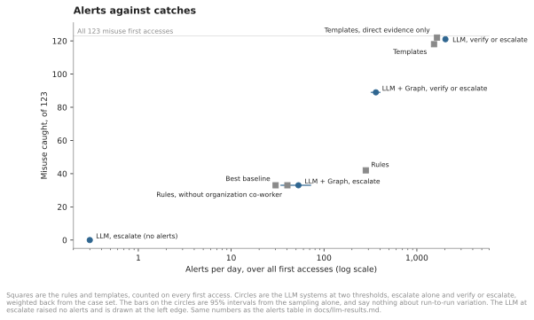

# ehr-access-triage

Can an LLM triage anomalous accesses to electronic health records (EHR) and draft the case summary a hospital Privacy Officer would review? This repo tests that question on synthetic data.

## What it found

One model, GLM 5.3 Flash on a 4-bit endpoint, on one synthetic hospital, two passes. The full reading is in [docs/results-reading.md](docs/results-reading.md) and the numbers in [docs/llm-results.md](docs/llm-results.md).

- **An LLM that reads audit-log lines alone cannot triage.** It escalated nothing and asked for a human on 89% of first accesses.
- **Grounded on an identity graph it becomes useful, and as first worded it is not better than a simple baseline.** It escalated 36 of 123 misuse accesses at 52 alerts a day. Relationship rules followed by an explanation filter catch 33 at 30 a day, and within a small daily review budget they find about twice as much.
- **It catches misuse that a relationship explains and misses misuse that only behavior shows.** It escalated every coworker and household-relative case, and none of the 21 news-event cases even with the other readers of the news in its prompt.
- **Its extra alerts fall on staff charts, and the wording of one fact causes most of them.** Told that a patient is a member of staff, instead of being shown an "organization co-worker connection", it escalated 8 of 68 undocumented legitimate staff-chart accesses instead of 50. It then raised 11 alerts a day at 9.0% precision against the baseline's 30 at 3.6%, and found more misuse within every daily review budget, while giving up 5 catches, mostly on staff patients. This variant was declared after the results, with its pass mark fixed before it ran, and has one pass so far.
- **One answer is one draw.** At temperature 0, 16% of its cases got a different answer on rerun, while the totals barely moved.
- **Covering accesses did not hide targets,** beyond what rerunning alone changes.
- **Its summaries cite real facts.** A second model's ratings of those claims were checked on a blinded sample, and its "unsupported" verdict turned out unreliable, so no error rate is quoted.



## Status

Built and run. The generator, the identity graph, two baselines, two LLM systems, a faithfulness check, the scoring and thirteen figures are in place, and the corrected design has two passes. An outside review of the repository by a model from another lab, given none of the project's own notes, found that the first LLM pass was shown some evidence from the future and too little context, and that its predictions had no fixed pass mark. The design was corrected before any further pass ([spec section 11](docs/spec.md)). That first pass is kept as an exploratory run under the tag `pass1-exploratory` and is not pooled with the rest.

## The idea

Detection of suspicious EHR access has been studied since 2011, and explanation-based auditing already explains most accesses automatically. The step after detection has had far less attention. Someone still has to investigate each unexplained access and write it up.

The working hypothesis was that LLM triage of these accesses fails without grounding in an identity graph, meaning who the user is, their role and department, their care-team assignments and their relationships to the patient, and that with that grounding it may clear legitimate accesses and write summaries that stick to the evidence. The project was built to test that, including the ways it could turn out to be wrong.

Four systems are compared on the same logs.

1. Rules, the five evaluated by Hedda et al. (2017)
2. Explanation templates in the style of Fabbri and LeFevre (2013)
3. An LLM reading raw log lines
4. The same LLM grounded on facts from the identity graph

The unit is a first access, one user opening one patient's chart for the first time in a week, as in both papers. The LLM systems answer clear, verify or escalate, and draft a triage note in which every claim cites the facts it rests on. Before any system ran, the spec predicted how each would handle each scenario, and those predictions are scored by a rule fixed in advance.

## Synthetic data only

Every patient, staff member, encounter and access event in this project is synthetic. Patients come from [Synthea](https://github.com/synthetichealth/synthea). Staff, care teams and access logs are generated by the code in this repo.

No real patient data and nothing derived from any real system is used anywhere. This is an academic research project.

## Public sources only

The schema, the misuse scenarios and the calibration targets come from published papers, the audit-log field list in the Herrera Montano et al. preprint and public summaries of the ASTM E2147 audit-log standard. Volumes, repeat rates and rule matches follow US audit-log studies. How unevenly activity is spread across users follows the UK log. Each parameter in [config/calibration.yaml](config/calibration.yaml) names the source it came from, and parameters with no published source are marked as assumptions.

## What a run produces

One run writes three folders.

- `logs/` holds the audit log. Each event has a timestamp, user, patient, device, action and duration.
- `context/` holds what a hospital would know about its people and their care, such as staff, schedule, encounters, care teams and orders.
- `labels/` holds the ground truth, meaning why each access happened, the injected misuse scenarios and the true family ties. No system under test reads this folder.

The default run has about 400 staff, 3,500 patients and about 676,000 events. The scenarios and what each system was expected to catch are in [docs/spec.md](docs/spec.md).

## How close it is to real logs

The [calibration report](docs/calibration-report.md) puts every published target next to the generated value. Access volume, the repeat share, self-access, nurse chart time and the share of first accesses with direct evidence are on or near target. Others miss, and the misses are reported as they are.

- Staff are about 11% of the patient population here, so about 13% of first accesses open a staff chart against 3.84% in Hedda et al. Most of the grounded LLM's extra alerts rest on this gap, and the report shows every system with staff charts weighted back to the published share.
- First accesses explained once departmental responsibility is added come to 27% against a published 41%.
- Activity is spread more evenly across users than in the real UK log, which has a long tail of very heavy users.
- In real logs, the relationship rules fire 1.5 to 4 times more often than chance. Here they fire 1.3 to 1.8 times more often.

## Run it

```
uv venv && uv pip install -e ".[dev]"
scripts/run_synthea.sh           # needs Java 11 or newer, writes data/synthea/slim
python -m ehr_triage.generate    # writes data/generated/seed42 in a few seconds
python -m ehr_triage.generate --covered   # the paired run with covering accesses
python -m ehr_triage.report      # rewrites docs/calibration-report.md
python -m ehr_triage.evaluate    # rewrites docs/baseline-results.md
pytest
```

The tests use a small made-up population, so they need neither Java nor Synthea.

## Run the LLM systems

The two LLM systems call OpenRouter's chat completions endpoint. Copy `.env.example` to `.env` and fill in the key. The address and the two model names are already there, and the provider endpoints are pinned in the config. `.env` is gitignored.

```
python -m ehr_triage.evaluate cases          # picks the 1,673 first accesses to triage
python -m ehr_triage.triage run --limit 20   # a cheap trial, prints what the full set would cost
python -m ehr_triage.triage run              # both systems on every case, into results/
python -m ehr_triage.triage judge            # checks each claim against the facts it cites
python -m ehr_triage.triage run --pass 2     # a repeat pass, for run-to-run variation
python -m ehr_triage.triage run --systems llm_graph_employment   # the declared variant of spec 11.9, about 1.10 USD
python -m ehr_triage.evaluate llm            # writes docs/llm-results.md
python -m ehr_triage.figures                 # rewrites the figures in docs/figures/
python -m ehr_triage.triage render --case C0100   # one answer as the case summary an officer would read
```

A run can be stopped and started again. It skips the cases already answered and stops by itself at the cost cap set in the config. One pass of both systems on both runs costs about 2.20 USD and the judge about 2 USD. The answers of every pass are committed under `results/`, so the reports and figures can be rebuilt without calling a model. The exploratory first pass is rebuilt by checking out the tag `pass1-exploratory`.

## Layout

```
config/    calibration parameters, each with its source
docs/      spec, calibration report, results, the reading and the figures
src/       generator, identity graph, baselines, LLM triage, scoring and figures
results/   model answers, one JSON line per case and pass
tests/
scripts/   Synthea download, run and slim-down
data/      Synthea output and generated runs (not in git)
vendor/    Synthea jar (not in git)
```

## License

MIT. See [LICENSE](LICENSE).
