# Reading of the LLM triage results

Written on 19 Nov 2026 from the corrected design (spec section 11), passes 1 and 2, and the declared variant of spec 11.9 (two passes and a judge run, 21 Nov 2026). Every number here comes from `llm-results.md`, `baseline-results.md` or `calibration-report.md`, which are written by code, except the blinded read of the judge, which is in `judge-review.md`. The exploratory pass 1 of 14 Nov 2026, run before an outside review corrected what the models were shown, is kept apart under the tag `pass1-exploratory` and is not used here.

This is one model, GLM 5.3 Flash on a 4-bit endpoint, on one synthetic hospital. Read every result with that in mind.

## In short

- **An LLM that reads audit-log lines alone cannot triage.** In both passes it escalated nothing and asked for a human on 89% of first accesses. Its precision is the base rate of misuse.
- **With the identity graph it becomes useful, and it is not better than a simple baseline.** It escalated 36 of 123 misuse accesses in pass 1 and 35 in pass 2. Rules followed by an explanation filter catch 33, with 30 alerts a day against its 52.
- **It catches misuse that a relationship explains, and misses misuse that only behavior shows.** It escalated every coworker and household-relative case and none of the 21 news-event cases, even with the other readers of the news in its prompt. It cleared 13 of 21 off-shift shared-credential cases while being shown the off-shift line.
- **Its extra alerts fall on staff charts, and the wording of one fact causes most of them.** Told that a patient is a member of staff instead of being shown an "organization co-worker connection", it escalated 8 of 68 undocumented legitimate accesses on staff charts instead of 50, and fell from 52 alerts a day to 11. Its precision rose to 9.0%, against the baseline's 3.6%, and within every daily review budget it found more misuse than the baseline. It gave up 5 misuse catches, mostly misuse on staff patients. A second pass of the variant held: 4 of 68 escalated, 9 alerts a day, 11.3% precision, with summaries as faithful as the grounded system's. The variant was declared after the results were seen, so it is the strongest result here and the one most in need of a fresh test. On other charts the original wording already matched the baseline with fewer alerts. This synthetic hospital opens staff charts about three times as often as the published data. Weighted down to the published share, it raises 21 alerts a day against the baseline's 16, at 5.8% precision against 7.0%. The gap narrows and does not close.
- **One answer is one draw.** At temperature 0, 16% of its cases got a different answer on rerun. The totals barely moved.
- **Covering accesses did not hide targets.** Adding them changed about as many answers as rerunning did.
- **Its summaries cite what they were shown.** Nearly every claim points to real facts. A blinded read of 36 judged claims found 2 wrong. The judge's "supported" held on all 12 read, and its "unsupported" on only 1 of 12.

What follows from this for anyone building such a system. Ground the model or do not use it, word the facts it is given with care, since one word turned a colleague's chart into a "connection" and most of its false alerts with it, expect it otherwise to reproduce what rules and explanations already do, do not rely on it for misuse that shows only across users or sessions, and treat its answer on a single case as a suggestion to be read, not a decision.

## Names used here

| Name here | What it is | Name in the generated reports |
|---|---|---|
| Rules | The five relationship rules of Hedda et al. (2017). An alert is a rule that fires | Rules, all five |
| Templates | Explanation templates after Fabbri and LeFevre (2013). An alert is an access with no explanation | Templates, direct and responsibility |
| LLM | The model, shown log lines only | LLM on log lines |
| LLM + Graph | The same model, shown the log lines and facts from the identity graph | LLM with identity graph |
| Best baseline | Rules, with an alert dropped when direct evidence explains the access, as Hedda et al. propose | Rules, then direct evidence |

A **first access** is one user opening one patient's chart for the first time in a week. The run has 63,872, and 123 are misuse. Both LLM systems were sent the same 1,673 cases, all 123 misuse accesses and a fixed number of each legitimate kind, and population figures are weighted back by kind. Each LLM answer is one of three. **Clear** leaves the access alone, **verify** asks the user's supervisor, and **escalate** sends it to the Privacy Officer. **Flag** means verify or escalate, since both put the access in front of a reviewer.

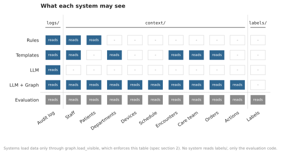

*Figure 1.* Read across a row to see what a system may load. The LLM gets the audit log and nothing else, and only the evaluation code reads the labels.

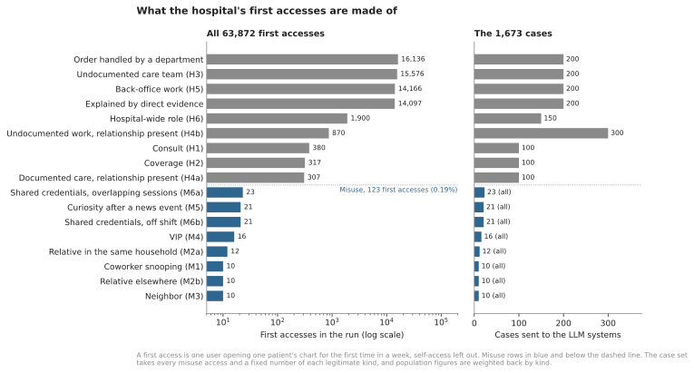

*Figure 2.* Misuse is a sliver of the hospital's first accesses, so the case set keeps all of it and samples the rest.

## The design

The hospital is synthetic, so every access has a known cause. Patients come from Synthea. Staff, schedules, care teams, orders and devices are generated, and the log is calibrated to published audit-log studies. Misuse is injected by scenario. Coworker snooping (M1), relatives in the same household (M2a) and elsewhere (M2b), neighbors (M3), VIPs (M4), curiosity after a news event (M5), and shared credentials, overlapping (M6a) or off shift (M6b). Legitimate accesses include hard negatives built to look like misuse, such as consults, undocumented coverage and back-office work.

The labels sit apart from the log and the context tables, and every system loads its data through one function that enforces what it may read. A care-team or order record explains an access only when the access falls between the day its encounter begins and a week after it ends. The LLM is shown the log lines nearest the week's accesses, and the LLM + Graph also the user's role and shifts, the patient's encounters, every named connection between the two, and what each device and action code is.

The spec predicted an outcome for every system on every scenario before any system ran. Those predictions are scored by a rule fixed before this design was run. A cell holds when 90% of its cases match the prediction, holds partly at 50% to 89%, and is contradicted below 50%.

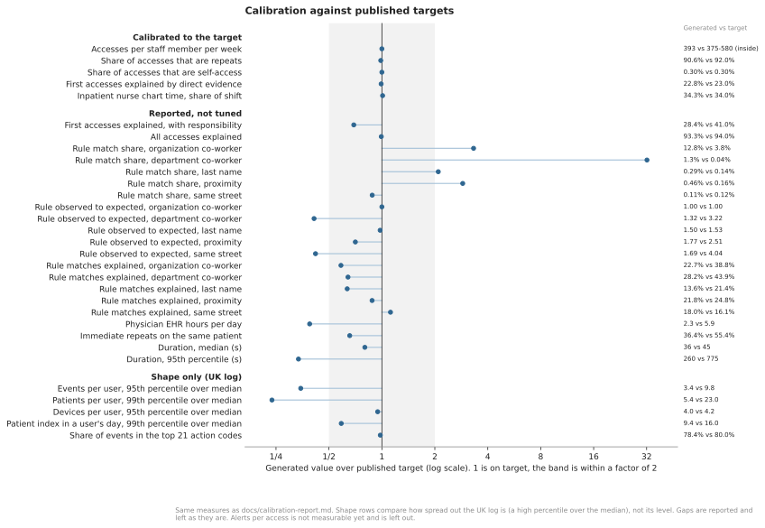

*Figure 3.* Each dot is a generated measure over its published target. The organization co-worker rule matches about 13% of first accesses against 3.84% in Hedda et al., because staff are 11% of patients here. That gap matters for question 5.

## The questions

1. Does the LLM need the identity graph to triage at all?
2. With the graph, which misuse does it escalate?
3. With the graph, does it clear legitimate work?
4. Is it better than the best baseline?
5. Where do its extra alerts come from?
6. Are its summaries faithful to the facts it was shown?
7. Do covering accesses hide a target from it?
8. How much do its answers change from run to run?
9. Is the staff-chart effect caused by how employment is worded?

Questions 1 to 3 split the project's working hypothesis. Questions 4, 6 and 7 are the measures the project set for itself. Question 5 was asked after the first results and is exploratory. Question 8 is why a second pass was run. Question 9 was declared after the corrected passes, with its criterion fixed before its run.

## Findings

### 1. Does the LLM need the identity graph?

**What was compared.** The LLM and the LLM + Graph on the same 1,673 cases, pass 1.

| | LLM | LLM + Graph |
|---|---|---|
| Misuse escalated, of 123 | 0 | 36 |
| Legitimate cases cleared, of 1,550 | 142 | 1,067 |
| Share of all first accesses flagged | 89% | 16% |

**Test.** McNemar's exact test, which reads only the cases where the two systems disagree. On misuse they disagreed 36 times, all in favor of the graph (p under 0.001). On legitimate work they disagreed 999 times, 962 of them in favor of the graph (p under 0.001).

**Reading.** Yes. Without the graph the model asks for a human on nearly everything, misuse and legitimate alike. Counting verify as an alert, its precision is 0.20%, the share of misuse in the data. A system with no information would do the same.

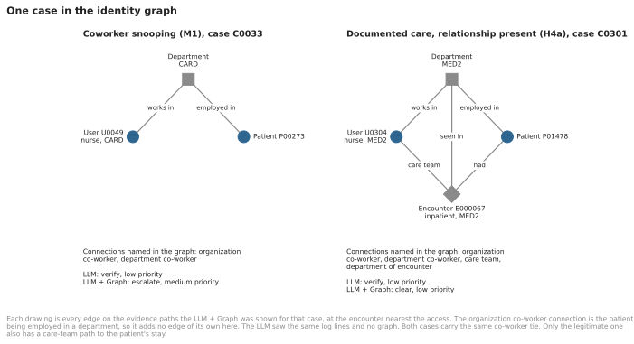

*Figure 4.* Both cases carry the same co-worker tie, and only the legitimate one has a care-team path to the patient's stay. The LLM + Graph escalated the first and cleared the second. The LLM answered verify to both.

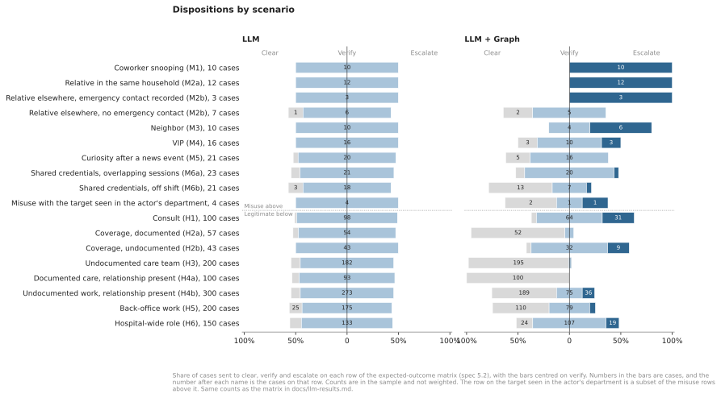

*Figure 5.* Without the graph every bar is verify. With it, relationship misuse moves to escalate and documented care to clear, while news-event and shared-credential misuse stays at clear or verify.

### 2. With the graph, which misuse does it escalate?

**What was compared.** The LLM + Graph's answers on each misuse scenario, pass 1, and whether the sign that defines the scenario was in its prompt.

| Scenario | Cases | Clear | Verify | Escalate |
|---|---|---|---|---|
| Coworker snooping (M1) | 10 | 0 | 0 | 10 |
| Relative in the same household (M2a) | 12 | 0 | 0 | 12 |
| Relative elsewhere, emergency contact recorded (M2b) | 3 | 0 | 0 | 3 |
| Relative elsewhere, no emergency contact (M2b) | 7 | 2 | 5 | 0 |
| Neighbor (M3) | 10 | 0 | 4 | 6 |
| VIP (M4) | 16 | 3 | 10 | 3 |
| Curiosity after a news event (M5) | 21 | 5 | 16 | 0 |
| Shared credentials, overlapping sessions (M6a) | 23 | 2 | 20 | 1 |
| Shared credentials, off shift (M6b) | 21 | 13 | 7 | 1 |

The sign was in the prompt for all 21 news-event cases, a line by another user who opened the same patient after the news. It was there for 21 of 23 overlapping-session cases and, through the schedule, all 21 off-shift cases.

**Reading.** It escalates misuse that a connection in the graph explains, and the relationships it was shown are the ones that define those scenarios, so that part is built in. It does not escalate misuse that only shows in behavior, even when the evidence is in front of it. The news-event and shared-credential cases are a pattern across users or sessions, and a model that judges one access at a time does not read them as a concern. The 3 VIP escalations all come from one injection. Counted by injection, it escalated at least one access in 1 of 10 VIP injections, 0 of 2 news events and 1 of 5 shared logins of each kind.

### 3. With the graph, does it clear legitimate work?

**What was compared.** The LLM + Graph's answers on each legitimate kind, pass 1.

| Kind of access | Cases | Clear | Verify | Escalate |
|---|---|---|---|---|
| Explained by direct evidence | 200 | 198 | 2 | 0 |
| Documented care, relationship present (H4a) | 100 | 100 | 0 | 0 |
| Undocumented care team (H3) | 200 | 195 | 3 | 2 |
| Order handled by a department | 200 | 192 | 7 | 1 |
| Coverage (H2) | 100 | 54 | 37 | 9 |
| Back-office work (H5) | 200 | 110 | 79 | 11 |
| Undocumented work, relationship present (H4b) | 300 | 189 | 75 | 36 |
| Hospital-wide role (H6) | 150 | 24 | 107 | 19 |
| Consult (H1) | 100 | 5 | 64 | 31 |

**Reading.** It clears work that a record explains and work done by the patient's own unit. It does not clear work whose purpose is undocumented. It sends most consults and hospital-wide work to verify and escalates about a third of consults. The spec predicted it would clear those, and the prediction is contradicted for consults and hospital-wide work.

### 4. Is it better than the best baseline?

**What was compared.** The LLM + Graph at escalate and the best baseline, pass 1.

| | Best baseline | LLM + Graph |
|---|---|---|
| Alerts per day | 30 | 52 (95% interval 34-70) |
| Misuse caught, of 123 | 33 | 36 |
| Precision | 3.61% | 2.32% |
| Misuse found, 10 alerts reviewed a day | 16 | 6 |
| Misuse found, 25 a day | 29 | 16 |
| Misuse found, 50 a day | 33 | 34 |

**Test.** On catches, McNemar's exact test. The LLM + Graph caught 8 accesses the baseline missed and the baseline 5 it missed (p = 0.58). On alert volume the baseline is counted on every first access, and the LLM + Graph's interval from the sample lies above it.

**Reading.** No. The two catch about the same misuse, not the same accesses. The LLM + Graph adds relatives with a recorded emergency contact and VIP accesses that no rule sees, and the rules add cases the model left at verify. It raises more alerts, and within a small review budget it finds about half as much. The budget figures score an average day pooled over the month, not a daily queue.

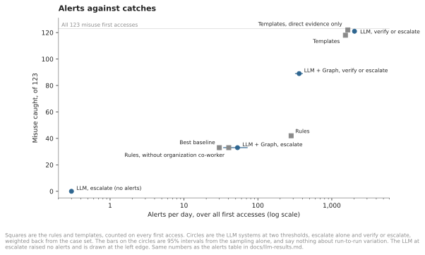

*Figure 6.* The LLM + Graph at escalate sits beside the best baseline with a few more catches and more alerts. The LLM at escalate raised none, and its bar runs to the most the sample allows.

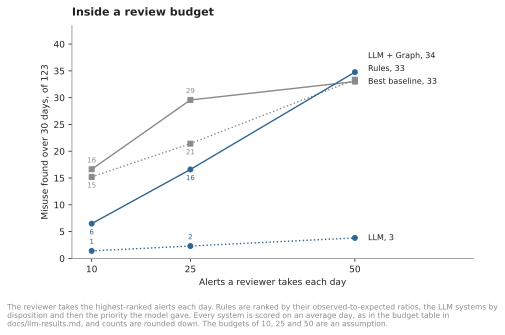

*Figure 7.* At 10 and 25 alerts a day the best baseline finds about twice as much misuse. At 50 the two meet.

### 5. Where do its extra alerts come from?

**What was compared.** Alerts and catches on staff charts and on other charts, pass 1. Staff are 11% of patients here.

| | Staff charts, alerts a day | Caught, of 20 | Other charts, alerts a day | Caught, of 103 | Precision on other charts |
|---|---|---|---|---|---|
| Best baseline | 21 | 11 | 10 | 22 | 7.41% |
| LLM + Graph | 43 (margin 17) | 15 | 8 (margin 5) | 21 | 8.46% |

**Test.** The Cochran-Mantel-Haenszel test asks whether a legitimate access is more likely to be escalated when the patient is staff, within the same kind of access. It is (common odds ratio about 4, p under 0.001). Kind by kind the pattern is sharp where the purpose is undocumented. On staff charts it escalated 11 of 22 back-office accesses, 17 of 20 hospital-wide, 9 of 12 coverage and 13 of 14 consults. On other charts the same kinds were escalated 0 of 178, 2 of 130, 0 of 88 and 18 of 86. For undocumented work by someone with a relationship it goes the other way, 18 of 202 on staff charts against 18 of 98.

**Reading.** Nearly all of the gap with the baseline is on staff charts. On other charts the LLM + Graph raises fewer alerts and catches about as much. The prompt names "a personal connection with no job-related purpose" as a concern, and the graph names employment in a department as a connection, so a staff chart opened without a documented purpose reads as exactly that. Two cautions. This question was asked after results were seen, so it is exploratory. And the hospital overstates it, since staff charts are opened about three times as often as in the data of Hedda et al.

**What if staff charts were as rare as in the published data?** A sensitivity check, also asked after the results. Every legitimate first access on a staff chart is weighted by 0.27, so that staff charts make up 3.84% of first accesses, and misuse keeps its count. Nothing is run again.

| | Alerts a day, as run | Reweighted | Precision, as run | Reweighted |
|---|---|---|---|---|
| Best baseline | 30 | 16 | 3.61% | 6.96% |
| LLM + Graph, escalate | 52 | 21 | 2.32% | 5.84% |

Both systems lose alerts, the LLM + Graph more of them. It ends close to the baseline and still a little less precise, catching 36 against 33. So the calibration gap explains most of the difference in alert volume and not all of it.

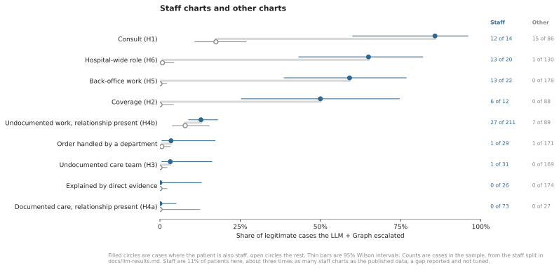

*Figure 8.* On consult, hospital-wide, back-office and coverage work, the LLM + Graph escalates most of the staff charts and few of the others.

### 6. Are its summaries faithful to the facts?

**What was compared.** The claims in the purpose-evidence and risk-indicator parts of each summary, pass 1. A first check in code asks whether each claim cites facts that were shown. A judge model, DeepSeek V4.1 Flash, then rates each claim that passed.

| | LLM | LLM + Graph |
|---|---|---|
| Claims | 6,605 | 10,957 |
| Cite only facts that were shown | 99.8% | 99.9% |
| The same, when a range such as L2-L31 does not count | 90.6% | 96.0% |
| Judge, supported | 63.2% | 65.5% |
| Judge, partly | 33.7% | 32.8% |
| Judge, unsupported | 3.0% | 1.7% |

**A blinded read.** 36 of the judge's verdicts were read again, six for each verdict and system, with the verdicts sealed until every reading was written down. The reader was Claude, the assistant that built the repository, so this is a second model's check and not a person's. Each claim and both readings are in `judge-read-corrected-pass.csv`.

| Judge said | Read as supported | Read as partly | Read as unsupported |
|---|---|---|---|
| Supported, 12 | 10 | 2 | 0 |
| Partly, 12 | 3 | 8 | 1 |
| Unsupported, 12 | 7 | 4 | 1 |

**Reading.** The summaries cite what they were shown, and when the judge calls a claim supported it is right. When it calls a claim unsupported it is usually wrong, rejecting plain statements such as "all three actions are A0335, a read". One wrong claim, a count of six patients where the prompt shows five, sat under partly. Two of the 36 claims read were wrong. Six claims to a cell cannot give an error rate for the pass, so none is given, and the judge's unsupported share should not be quoted as one. "Partly" usually means a correct observation with an inference attached, such as "consistent with routine work", or a correct count that cites only some of its lines. The narrative and the rationale are not checked at all.

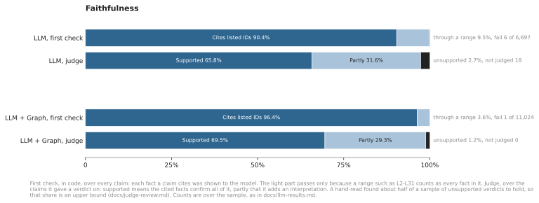

*Figure 10.* Nearly every claim passes the citation check, about a tenth of the LLM's only because ranges count. The dark sliver on the judge bars is the share it rated unsupported.

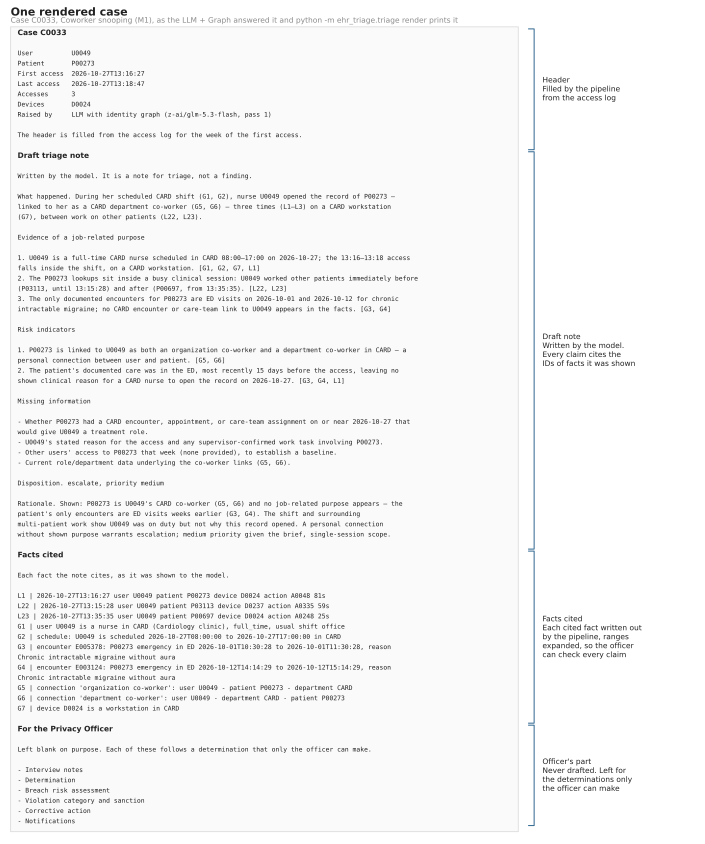

*Figure 13.* What a Privacy Officer would read for the coworker case of figure 4. Every claim points to facts written out below it, and the officer's part is blank.

### 7. Do covering accesses hide a target?

**What was compared.** The 58 coworker, relative, neighbor and VIP targets, triaged by the LLM + Graph in the base run and in a paired run where each actor also opened 10 covering charts within an hour of the target. Both runs were sent twice.

| Comparison | Targets whose escalation changed, of 58 |
|---|---|
| Base run, pass 1 against pass 2 | 5 |
| Paired run, pass 1 against pass 2 | 3 |
| Without against with cover, pass 1 | 7 |
| Without against with cover, pass 2 | 5 |

**Test.** McNemar's exact test on pass 1 found 3 changes one way and 4 the other (p = 1.0). That alone would not show the covers have no effect, so the table sets them beside rerunning alone.

**Reading.** No sign that covering accesses hide a target. They change about as many answers as rerunning does, and the escalation count is 34 without cover and 35 with it. 58 targets can only show a large effect, and only one attack with one setting was tried.

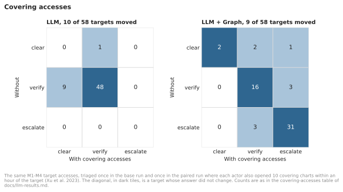

*Figure 11.* Most targets sit on the diagonal, and the moves off it go both ways.

### 8. How much do its answers change from run to run?

**What was compared.** Pass 1 and pass 2, the same prompts and settings at temperature 0.

| | LLM | LLM + Graph |
|---|---|---|
| Misuse escalated, pass 1 and pass 2 | 0 and 0 | 36 and 35 |
| Escalations a day, pass 1 and pass 2 | 0 and 0 | 52 and 54 |
| Cases with the same answer in both passes | 86.7% | 83.7% |
| The same, weighted to all first accesses | 84.0% | 86.8% |

For the LLM + Graph, 204 cases moved between clear and verify and 60 between verify and escalate. 8 moved straight between clear and escalate. The least stable kinds are back-office work (112 of 200 the same), consults (71 of 100), undocumented work with a relationship (222 of 300), neighbors (6 of 10) and off-shift shared credentials (15 of 21).

**Reading.** The totals are stable and the single answers are not. A case answered verify once may be cleared or escalated the next time, and the cases that move most are the ones the model is least sure about. Any use that rests on one answer per case inherits that. Five cells of the matrix change mark between passes for the same reason, and they are marked unstable below.

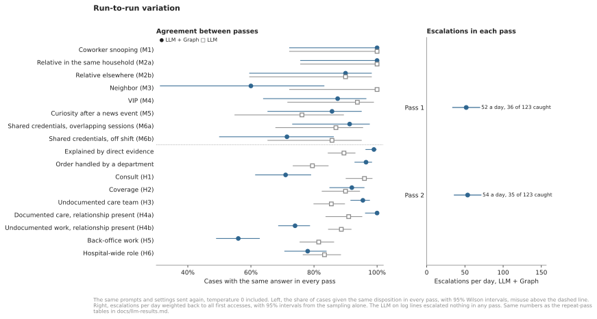

*Figure 12.* Agreement is near 100% on documented care and relationship misuse and falls to 56% on back-office work and 60% on neighbors. Escalations per day are the same in both passes.

### 9. Is the staff-chart effect caused by how employment is worded?

**What was compared.** The grounded system and a declared variant that differs in one fact line (spec 11.9). Where the patient is staff, the variant's prompt says "patient P is a member of staff, in department D" in place of an organization co-worker connection. The department co-worker connection stays. 463 of 1,831 prompts differ, all on staff charts. The criterion was fixed before the variant ran. It looks at legitimate consult, coverage, back-office and hospital-wide work on staff charts, 68 cases.

| | Grounded, pass 1 | Grounded, pass 2 | Variant, pass 1 | Variant, pass 2 |
|---|---|---|---|---|
| Undocumented work on staff charts escalated, of 68 | 50 | 55 | 8 | 4 |
| Coworker snooping escalated, of 10 | 10 | 10 | 10 | 9 |
| Misuse escalated, of 123 | 36 | 35 | 31 | 32 |
| Escalations a day | 52 | 54 | 11 | 9 |
| Precision | 2.32% | 2.18% | 9.01% | 11.33% |

**Test.** McNemar's exact test on the 68 cases, variant against pass 1. 42 were escalated only in pass 1 and none only by the variant (p under 0.001). Between the grounded system's own two passes, 11 of the same cases changed (3 one way, 8 the other, p = 0.23). All three parts of the criterion hold. On misuse the variant and pass 1 disagree 7 times one way and 2 the other (p = 0.18). The criterion was fixed for the variant's first pass. Its second pass, run to check that the result holds, escalated 4 of the 68 against pass 1 of the grounded system's 50 (46 one way, none the other, p under 0.001). The variant's two passes agreed on 80.9% of all cases, the grounded system's on 83.7%.

| | Staff charts, a day | Other charts, a day | Found at 10 a day | At 25 | At 50 |
|---|---|---|---|---|---|
| Best baseline | 21 | 10 | 16.6 | 29.6 | 33.0 |
| Grounded, pass 1 | 43 | 8 | 6.5 | 16.6 | 34.8 |
| Variant | 5 | 7 | 23.7 | 36.8 | 47.4 |

**Reading.** Yes, most of it. Named as a connection, employment read to the model as the "personal connection with no job-related purpose" its instructions warn about. Named as a fact, it did not, and the staff-chart escalations of undocumented work fell from 50 to 8. Alerts on other charts barely moved. With that change the grounded LLM is the first system here to beat the baseline. It raises a third of the baseline's alerts at more than twice its precision, and within each review budget it finds more misuse, because its escalations and its higher-priority verify answers rank the misuse first. It paid for this on staff patients. The three accesses to a VIP who is also staff and one shared-credential access on a staff patient, all escalated before, went to verify. The other changes were neighbor cases that also flip between the grounded system's own passes.

**Faithfulness.** The judge read the variant's pass 1 the same way as the other systems. Of 11,024 claims judged, 66.5% were supported, 31.9% partly and 1.7% unsupported, against 65.5%, 32.8% and 1.7% for the grounded system. 11,113 of 11,119 citations point to facts that exist. Rewording the fact did not make the summaries less faithful. The blinded read of question 6 applies here too: "supported" can be trusted, "unsupported" cannot be read as wrong.

**The repeat.** It held. The second pass escalated fewer of the 68, raised fewer alerts and kept the misuse total. One coworker snooping case went from escalate to verify, the first coworker case any grounded pass did not escalate. With 10 such cases, one miss in one pass is within run-to-run variation, and it is worth watching.

One caution remains. The variant was conceived after the results were seen. The criterion protects against reading noise as an effect and the repeat against a lucky pass, but neither protects against having chosen a good question in hindsight. Only a fresh test would, for example on a new seed of the hospital.

## The matrix

The spec predicted an outcome for each system on each scenario before any system was run. The table scores each prediction with the rule above, in both passes. "Left alone" means no rule fired, an explanation was found, or the model answered clear. "Alerted" means a rule fired, no explanation was found, or the model escalated. Only the LLM systems answer verify. Counts are from pass 1. Rules and Templates are counted on every first access and the LLM systems on the cases they were sent. Scenarios starting with M are misuse and those starting with H are legitimate work that is hard to tell from it.

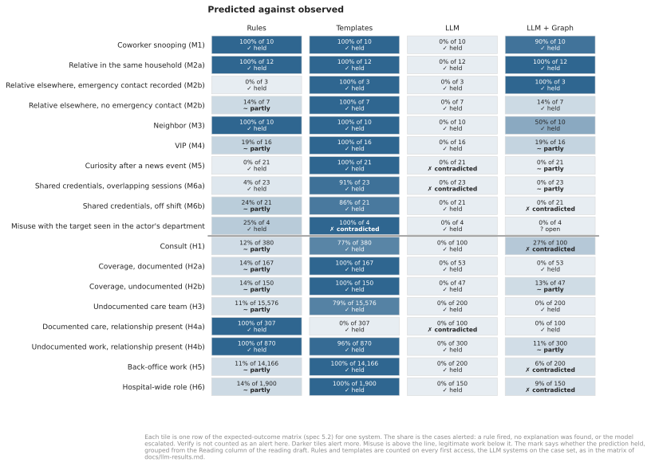

*Figure 9.* Read down a column for one system. Templates hold almost everywhere by alerting on most first accesses. The LLM's "held" on news-event and shared-credential misuse only reflects that it flags nearly everything. The LLM + Graph's contradictions sit on off-shift shared credentials and on legitimate work with no documented purpose.

| System | Scenario | Predicted | Cases | Left alone | Verify | Alerted | Mark, pass 1 | Mark, pass 2 |
|---|---|---|---|---|---|---|---|---|
| Rules | Coworker snooping (M1) | flag | 10 | 0 | - | 10 | held | held |
| Rules | Relative in the same household (M2a) | flag | 12 | 0 | - | 12 | held | held |
| Rules | Relative elsewhere, emergency contact recorded (M2b) | miss | 3 | 3 | - | 0 | held | held |
| Rules | Relative elsewhere, no emergency contact (M2b) | miss | 7 | 6 | - | 1 | partly | partly |
| Rules | Neighbor (M3) | flag | 10 | 0 | - | 10 | held | held |
| Rules | VIP (M4) | miss | 16 | 13 | - | 3 | partly | partly |
| Rules | Curiosity after a news event (M5) | miss | 21 | 21 | - | 0 | held | held |
| Rules | Shared credentials, overlapping sessions (M6a) | miss | 23 | 22 | - | 1 | held | held |
| Rules | Shared credentials, off shift (M6b) | miss | 21 | 16 | - | 5 | partly | partly |
| Rules | Misuse with the target seen in the actor's department | as each case's own scenario | 4 | 3 | - | 1 | held | held |
| Rules | Consult (H1) | clear | 380 | 333 | - | 47 | partly | partly |
| Rules | Coverage, documented (H2a) | clear | 173 | 148 | - | 25 | partly | partly |
| Rules | Coverage, undocumented (H2b) | clear | 156 | 135 | - | 21 | partly | partly |
| Rules | Undocumented care team (H3) | clear | 16,134 | 14,336 | - | 1,798 | partly | partly |
| Rules | Documented care, relationship present (H4a) | false alert | 295 | 0 | - | 295 | held | held |
| Rules | Undocumented work, relationship present (H4b) | false alert | 882 | 0 | - | 882 | held | held |
| Rules | Back-office work (H5) | clear | 14,166 | 12,576 | - | 1,590 | partly | partly |
| Rules | Hospital-wide role (H6) | clear | 1,900 | 1,640 | - | 260 | partly | partly |
| Templates | Coworker snooping (M1) | flag | 10 | 0 | - | 10 | held | held |
| Templates | Relative in the same household (M2a) | flag | 12 | 0 | - | 12 | held | held |
| Templates | Relative elsewhere, emergency contact recorded (M2b) | flag | 3 | 0 | - | 3 | held | held |
| Templates | Relative elsewhere, no emergency contact (M2b) | flag | 7 | 0 | - | 7 | held | held |
| Templates | Neighbor (M3) | flag | 10 | 0 | - | 10 | held | held |
| Templates | VIP (M4) | flag | 16 | 0 | - | 16 | held | held |
| Templates | Curiosity after a news event (M5) | flag | 21 | 0 | - | 21 | held | held |
| Templates | Shared credentials, overlapping sessions (M6a) | flag | 23 | 2 | - | 21 | held | held |
| Templates | Shared credentials, off shift (M6b) | flag | 21 | 3 | - | 18 | partly | partly |
| Templates | Misuse with the target seen in the actor's department | miss | 4 | 0 | - | 4 | contradicted | contradicted |
| Templates | Consult (H1) | no test | 380 | 87 | - | 293 | no test | no test |
| Templates | Coverage, documented (H2a) | false alert | 173 | 0 | - | 173 | held | held |
| Templates | Coverage, undocumented (H2b) | false alert | 156 | 0 | - | 156 | held | held |
| Templates | Undocumented care team (H3) | no test | 16,134 | 3,244 | - | 12,890 | no test | no test |
| Templates | Documented care, relationship present (H4a) | clear | 295 | 295 | - | 0 | held | held |
| Templates | Undocumented work, relationship present (H4b) | no test | 882 | 38 | - | 844 | no test | no test |
| Templates | Back-office work (H5) | false alert | 14,166 | 0 | - | 14,166 | held | held |
| Templates | Hospital-wide role (H6) | false alert | 1,900 | 0 | - | 1,900 | held | held |
| LLM | Coworker snooping (M1) | miss | 10 | 0 | 10 | 0 | contradicted | contradicted |
| LLM | Relative in the same household (M2a) | miss | 12 | 0 | 12 | 0 | contradicted | contradicted |
| LLM | Relative elsewhere, emergency contact recorded (M2b) | miss | 3 | 0 | 3 | 0 | contradicted | contradicted |
| LLM | Relative elsewhere, no emergency contact (M2b) | miss | 7 | 1 | 6 | 0 | contradicted | contradicted |
| LLM | Neighbor (M3) | miss | 10 | 0 | 10 | 0 | contradicted | contradicted |
| LLM | VIP (M4) | miss | 16 | 0 | 16 | 0 | contradicted | contradicted |
| LLM | Curiosity after a news event (M5) | flag | 21 | 1 | 20 | 0 | held | partly |
| LLM | Shared credentials, overlapping sessions (M6a) | flag | 23 | 2 | 21 | 0 | held | held |
| LLM | Shared credentials, off shift (M6b) | miss | 21 | 3 | 18 | 0 | contradicted | contradicted |
| LLM | Misuse with the target seen in the actor's department | miss | 4 | 0 | 4 | 0 | contradicted | contradicted |
| LLM | Consult (H1) | no test | 100 | 2 | 98 | 0 | no test | no test |
| LLM | Coverage, documented (H2a) | no test | 57 | 3 | 54 | 0 | no test | no test |
| LLM | Coverage, undocumented (H2b) | no test | 43 | 0 | 43 | 0 | no test | no test |
| LLM | Undocumented care team (H3) | no test | 200 | 18 | 182 | 0 | no test | no test |
| LLM | Documented care, relationship present (H4a) | clear | 100 | 7 | 93 | 0 | contradicted | contradicted |
| LLM | Undocumented work, relationship present (H4b) | no test | 300 | 27 | 273 | 0 | no test | no test |
| LLM | Back-office work (H5) | no test | 200 | 25 | 175 | 0 | no test | no test |
| LLM | Hospital-wide role (H6) | no test | 150 | 17 | 133 | 0 | no test | no test |
| LLM + Graph | Coworker snooping (M1) | flag | 10 | 0 | 0 | 10 | held | held |
| LLM + Graph | Relative in the same household (M2a) | flag | 12 | 0 | 0 | 12 | held | held |
| LLM + Graph | Relative elsewhere, emergency contact recorded (M2b) | flag | 3 | 0 | 0 | 3 | held | held |
| LLM + Graph | Relative elsewhere, no emergency contact (M2b) | say it cannot confirm | 7 | 2 | 5 | 0 | partly | partly |
| LLM + Graph | Neighbor (M3) | flag | 10 | 0 | 4 | 6 | held | held |
| LLM + Graph | VIP (M4) | flag | 16 | 3 | 10 | 3 | partly | held |
| LLM + Graph | Curiosity after a news event (M5) | flag | 21 | 5 | 16 | 0 | partly | held |
| LLM + Graph | Shared credentials, overlapping sessions (M6a) | flag | 23 | 2 | 20 | 1 | held | partly |
| LLM + Graph | Shared credentials, off shift (M6b) | flag | 21 | 13 | 7 | 1 | contradicted | contradicted |
| LLM + Graph | Misuse with the target seen in the actor's department | open question | 4 | 2 | 1 | 1 | open question | open question |
| LLM + Graph | Consult (H1) | clear | 100 | 5 | 64 | 31 | contradicted | contradicted |
| LLM + Graph | Coverage, documented (H2a) | clear | 57 | 52 | 5 | 0 | held | held |
| LLM + Graph | Coverage, undocumented (H2b) | say it cannot confirm | 43 | 2 | 32 | 9 | partly | partly |
| LLM + Graph | Undocumented care team (H3) | clear | 200 | 195 | 3 | 2 | held | held |
| LLM + Graph | Documented care, relationship present (H4a) | clear | 100 | 100 | 0 | 0 | held | held |
| LLM + Graph | Undocumented work, relationship present (H4b) | clear, or say it cannot confirm | 300 | 189 | 75 | 36 | partly | partly |
| LLM + Graph | Back-office work (H5) | clear | 200 | 110 | 79 | 11 | partly | contradicted |
| LLM + Graph | Hospital-wide role (H6) | clear | 150 | 24 | 107 | 19 | contradicted | contradicted |

How to read some of the marks. The Rules' "partly" on legitimate work comes from one cause, the organization co-worker rule firing on staff charts, about three times as often as in the published data. The LLM's "contradicted" on M1 to M4 means it flagged them at verify where the spec expected a miss, and it flags legitimate work just as often. "No test" marks a prediction that any answer would meet.

## Limits

- One synthetic hospital, one model on one 4-bit endpoint, two passes.
- 123 misuse accesses from 62 injections, 60 scenarios and 2 news events. The 21 news-event accesses come from 2 events and the 44 shared-credential accesses from 10 shared logins, so they are not independent.
- Staff charts are opened about three times as often as in the published data, a gap reported and not tuned. Every alert count on staff charts carries it.
- The scoring rule was written after the exploratory pass 1 and before this design was run.
- The variant of question 9 was declared after the corrected passes were seen. It has two passes and a judge run.
- The judge's ratings were checked on 36 claims by a second model, not by a person, and give no error rate for the pass.
- The review budget is pooled over the month, not simulated day by day.
- The 7-day window after an encounter and the 15 minutes that define overlapping sessions are assumptions with no published source.

## What to do next

1. **Decide the stretch goal again.** Break-the-glass prompts and reason codes on staff and VIP charts would put a missing purpose on record. With the wording fixed, the staff-chart false alerts mostly go away without them, so the case for building it rests on the misuse the variant now leaves at verify and on legitimate work that is undocumented on any chart. The feasibility memo has the design and the costs.
2. **A fresh test of the variant**, on a new seed of the hospital, if its result is to be claimed rather than reported as found after the fact.
3. **A person's read of the judge**, if any faithfulness figure is to be quoted as a rate. The 36 claims in the CSV are a ready start.
